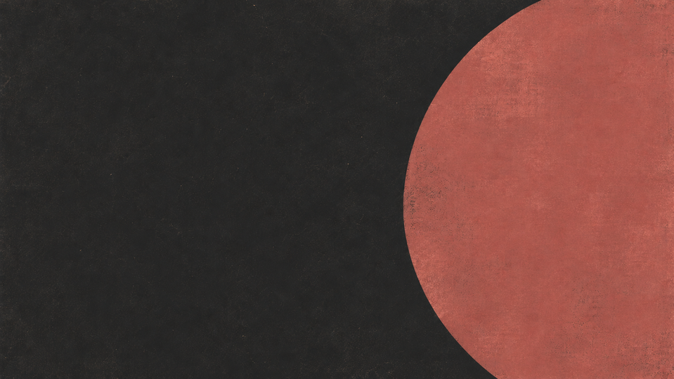

# Terracotta

A dark Omarchy theme with clay-colored window borders, charcoal backgrounds and muted rose accents. It includes a Foot palette, eza directory colors and four 4K wallpapers (3840 × 2160).

[](backgrounds/00-vinyl.webp)

## Install on Omarchy

Install the desktop palette, wallpapers and folder artwork with the Omarchy theme installer. Back up any existing local theme named `terracotta` first, as the installer replaces that directory.

```sh
omarchy theme install https://github.com/briginas/omarchy-terracotta-theme
```

After the first install, register the bundled folder icons with GTK. The link follows future updates to the installed theme.

```sh
mkdir -p "${XDG_DATA_HOME:-$HOME/.local/share}/icons"
ln -sT "$HOME/.config/omarchy/themes/terracotta/icons/Oldtale-Terracotta" "${XDG_DATA_HOME:-$HOME/.local/share}/icons/Oldtale-Terracotta"
```

## World Clock

The Elsewhen city slider can use the active palette’s `orange` color (`#CC9C86` in Terracotta). Its day and night track already follows the foreground color. To enable the slider color, run this once after installing the theme:

```sh
world_clock="$HOME/.config/omarchy/themes/terracotta/world-clock"
plugin="$HOME/.config/omarchy/plugins/$(id -un).elsewhen"
if [ ! -d "$plugin" ]; then
  omarchy plugin clone omarchy.elsewhen
fi
patch -d "$plugin" -p1 --forward < "$world_clock/daylight-marker.patch"
install -Dm644 "$world_clock/shell.elsewhen.toml.tpl" "$HOME/.config/omarchy/themed/shell.elsewhen.toml.tpl"
omarchy theme set terracotta
```

## Neovim

A matching Neovim colorscheme is available separately as [terracotta.nvim](https://github.com/briginas/terracotta.nvim).

## Foot, eza and icons

The [Foot palette](foot.ini) uses `#322E32` for the selection background and `#DFE1E5` for selected text. Omarchy generates its own Foot config for Git-installed themes.

To use Terracotta’s sage (`#94C0A4`) for the Git branch, the modified-file dot and the `?` for untracked files, copy the settings from [starship-git.toml](starship-git.toml) into the matching sections of `~/.config/starship.toml`.

[eza.yml](eza.yml) matches the folder colors in Neo-tree. To use it with eza, point `~/.config/eza/theme.yml` at `~/.local/state/omarchy/current/theme/eza.yml`.

Nautilus folders use the same terracotta (`#AD6866`) as the active window border. The bundled Oldtale-Terracotta icons inherit the remaining icons from Yaru-blue, provided by the Arch package `yaru-icon-theme`.

## Credits

The palette is derived from [WebStorm OldTale Dark](https://github.com/briginas/webstorm-oldtale-dark-theme). See the [license](LICENSE) and [third-party notices](THIRD_PARTY_NOTICES.md).
